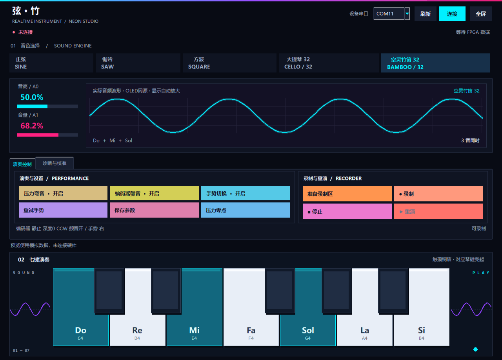

# 弦外之音：三 FPGA 协同实时电子乐器

**Three FPGA Cooperative Real-time Musical Instrument**

这是一个基于三块 Tang Nano 20K 的实时电子乐器原型。系统把控制采集、实时音频合成、显示和通信分配到三块 FPGA：A 板负责采集与调度，B/C 板负责并行声部合成，A 板完成混音并通过 I2S 输出到 MAX98357A 功放模块。

## 作品特点

- 七个电容触摸音键：Do、Re、Mi、Fa、Sol、La、Si，可同时按下形成和弦。
- 五种音色：正弦、锯齿、方波、大提琴和空灵竹笛。
- B/C 两板并行执行谐波声部；“32”表示每个音色使用 32 个谐波分量，不代表 32 个独立按键。
- ADSR 包络、双电位器控制音高与总音量、压力音高表情、旋转编码器颤音、PAJ7620 手势控制。
- OLED 四种显示模式、七音 LED 状态指示、电脑上位机和 ESP32-C3 手机 BLE 桥接。
- W25Q64 保存控制事件和时间信息，回放时重新合成声音，不保存预录 PCM 音频。

## 目录

| 目录 | 内容 |
|---|---|
| `src/` | Verilog 源码，包含公共模块、A/B/C 板级模块和 C 板显示覆盖模块 |
| `projects/` | Gowin 工程、引脚约束和时序约束 |
| `host/` | Python/Tkinter 电脑上位机；`start_host.bat` 可启动 |
| `mobile/` | 手机 Web Bluetooth 页面和 ESP32-C3 桥接源码 |
| `reference/` | 传感器参考源码、第三方许可和资料说明 |
| `docs/` | 功能说明、架构图和历史验证说明 |
| `sim/` | HDL 与协议测试源文件 |
| `validation/` | 既有测试日志和报告，报告中的“预览”图片是界面预览，不是实机测量 |
| `program/` | 烧录文件下载说明；实际 `.fs` 文件放在 GitHub Release 中 |

## 最快使用方式

1. 从 GitHub 的 **Releases** 下载三个 `.fs` 文件。
2. 按 `A_WIRING.md` 核对接线。
3. 用高云 Programmer 分别烧录 A、B、C 三块 Tang Nano 20K。A、B、C 文件不可互换。
4. 运行 `host/install_dependencies.bat` 安装电脑端串口依赖，再运行根目录的 `start_host.bat`。

电脑串口链路为：A52 → USB-TTL RXD，USB-TTL TXD → A86，GND 共地；USB-TTL 不给 FPGA 供电。手机链路为：A76 → ESP32-C3 GPIO5，ESP32-C3 GPIO4 → A80，GND 共地。两路 TX 不要并接。

## 从源码重新构建

需要 Gowin Education 软件和对应的 `gw_sh.exe`。可以设置环境变量 `GOWIN_GW_SH` 指向它，然后执行：

```text
python rebuild.py A
python rebuild.py B
python rebuild.py C
```

输出会写到 `rebuilt/`，不会覆盖 Release 中的稳定烧录文件。三板工程目标器件为 GW2AR-LV18QN88C8/I7。

电脑端测试：

```text
python -B -m unittest discover -s host -p "test_*.py"
```

手机协议测试需要 Node.js：

```text
node --test mobile/tests/protocol.test.cjs
```

## 真实状态与边界

这是参赛作品的工程归档和可复现实验材料。已有日志记录了模块级验证；完整系统的最终延迟、Flash 闭环和不同硬件批次的稳定性仍应以现场实测为准。没有把“32 谐波分量”写成“32 个独立音符”，也没有把电脑或手机说成音频合成核心。

工程目前没有选择一个覆盖全部文件的开源许可证。请先阅读 `LICENSE_STATUS.md` 和 `THIRD_PARTY_NOTICES.md`；公开源码不等于自动授予第三方任意再发布权。

## 相关资料

- [系统接线表](A_WIRING.md)
- [三板互连与 C 板接线](docs/BOARD_WIRING.md)
- [功能边界与验证记录说明](docs/PROJECT_STATUS.md)
- [三板协同架构图](docs/architecture_1.png)
- [并行谐波流水线图](docs/architecture_2.png)
- [采样协作时序图](docs/architecture_3.png)
- [实时合成与事件回放流程](docs/architecture_4.png)
- [手机 BLE 页面说明](mobile/README.md)
- [ESP32-C3 桥接说明](mobile/esp32c3_bridge/README.md)
- [第三方许可](THIRD_PARTY_NOTICES.md)

## 上位机界面预览

下图是界面布局预览，用于展示样式，并非硬件连接或性能测量证据。


